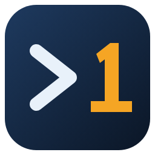

<p align="center">
  
</p>

# OneShot Remote SSH

Remote development over SSH for **VSCodium** and **Code - OSS**, with server setup in a
**single SSH command**. On hosts that put an MFA prompt on every SSH session (for example Duo
with `ForceCommand /usr/sbin/login_duo`), connecting costs **one** push instead of four.

This is a fork of [Open Remote - SSH](https://github.com/jeanp413/open-remote-ssh) by jeanp413
and contributors, distributed under the same MIT license. All credit for the extension itself
goes to the original project; this fork adds the changes listed below.

## Why

`login_duo` as a `ForceCommand` challenges every SSH *session channel*, not every login.
A terminal opens one channel, so it costs one push. Open Remote - SSH 0.5.0 runs each setup
step as its own channel:

| Setup step | Open Remote - SSH | + `remotePlatform` | + `remoteArch` (this fork) |
|---|---|---|---|
| Windows probe (`echo %COMSPEC%`) | push | skipped | skipped |
| `uname -s` | push | skipped | skipped |
| `uname -m` | push | push | skipped |
| install / start script | push | push | push |
| **Total** | **4** | **2** | **1** |

Port forwarding afterwards does not open session channels, so it does not trigger MFA.

## Changes in this fork

- **`remote.SSH.remoteArch`**: map of host to CPU architecture (`uname -m` value). Skips the
  architecture probe. Together with `remote.SSH.remotePlatform`, setup is a single command.
- **`"serverVersion": "latest"` without the GitHub API**: resolved through the
  `github.com/VSCodium/vscodium/releases/latest` redirect, which is not subject to the
  60 requests/hour anonymous API limit. The API stays as a fallback, and API errors now show
  GitHub's message instead of `.map is not a function`.
- Own extension ID (`guyliandejong.oneshot-remote-ssh`), name, icon, command prefix
  (`OneShot SSH:`) and log channel (`OneShot Remote SSH`).

Settings keep the `remote.SSH.*` names and connections keep the `ssh-remote+<host>` authority,
so existing settings, `.code-workspace` files and recent-folder entries keep working.

## Install

Close the editor first. The scripts download the latest release, remove extensions that claim
the same `ssh-remote` connections (`jeanp413.open-remote-ssh`, `ms-vscode-remote.remote-ssh`;
pass `--keep-others` / `-KeepOthers` to skip), install the VSIX and enable the proposed API in
`argv.json`.

Linux / macOS (VSCodium and/or Code - OSS):

```bash
curl -fsSLO https://raw.githubusercontent.com/GuyliandeJong/oneshot-remote-ssh/main/install/install.sh
bash install.sh
```

Windows (VSCodium):

```powershell
Invoke-WebRequest https://raw.githubusercontent.com/GuyliandeJong/oneshot-remote-ssh/main/install/install.ps1 -OutFile install.ps1
powershell -ExecutionPolicy Bypass -File .\install.ps1
```

Manual: download `oneshot-remote-ssh.vsix` from
[Releases](https://github.com/GuyliandeJong/oneshot-remote-ssh/releases), run
`codium --install-extension oneshot-remote-ssh.vsix`, and add the `argv.json` entry from
[Activation](#requirements).

Do not install it next to Open Remote - SSH or Microsoft Remote-SSH: they all register the
`ssh-remote` resolver.

## One MFA prompt per connection

Add per host, using the host name exactly as you connect to it (`Host` alias from
`~/.ssh/config`):

```json
"remote.SSH.remotePlatform": { "myserver": "linux" },
"remote.SSH.remoteArch":     { "myserver": "x86_64" }
```

`remoteArch` accepts what `uname -m` prints on the server: `x86_64`, `amd64`, `aarch64`,
`arm64`, `armv7l`, `armv8l`, `ppc64le`, `riscv64`, `loongarch64`, `s390x`.

Check the result in **Output -> OneShot Remote SSH**: `Detected platform` and
`Detected architecture` appear at the same moment, and only the install script waits on MFA.

A reconnect (for example after sleep) runs setup again and costs one prompt, the same as
Microsoft's Remote-SSH.

## SSH Host Requirements
You can connect to a running SSH server on the following platforms.

**Supported**:

- x86_64 Debian 8+, Ubuntu 16.04+, CentOS / RHEL 7+ Linux
- ARMv7l (AArch32) Raspbian Stretch/9+ (32-bit)
- ARMv8l (AArch64) Ubuntu 18.04+ (64-bit)
- IBM Z (s390x) Debian 13, RHEL 8+, Ubuntu 22.04+, SLES 15+
- macOS 10.14+ (Mojave)
- Windows 10+
- FreeBSD 13+ (Requires custom serverDownloadUrlTemplate setting)
- DragonFlyBSD (Requires manual remote-extension-host installation)

## Requirements

**Configuration**

You SSH server's configuration needs to have the following setting:
- `AllowTcpForwarding yes`

**Activation**

The extension uses the proposed `resolvers` API. VSCodium only pre-approves the original
`jeanp413.open-remote-ssh` ID, so this fork must be enabled in `argv.json` in VSCodium **and**
Code - OSS. The install scripts do this for you; to do it by hand:

```json
{
    ...
    "enable-proposed-api": [
        ...,
        "guyliandejong.oneshot-remote-ssh",
    ]
    ...
}
```
Open the file with the `Preferences: Configure Runtime Arguments` command
(`~/.vscode-oss/argv.json`, on Windows `%USERPROFILE%\.vscode-oss\argv.json`) and restart the editor.

**Alpine linux**

When running on alpine linux, the packages `libstdc++` and `bash` are necessary and can be installed via
running
```bash
sudo apk add bash libstdc++
```

## SSH configuration file

[OpenSSH](https://www.openssh.com/) supports using a [configuration file](https://linuxize.com/post/using-the-ssh-config-file/) to store all your different SSH connections.
To use an SSH config file, run the `OneShot SSH: Open SSH Configuration File...` command.

## SSH configuration guides

- [GSSAPI / Kerberos authentication](docs/gssapi-kerberos-authentication.md)
- [Jump hosts](docs/jump-hosts.md)

## Note for VSCode-OSS users

If you are using VSCode-OSS instead of VSCodium, you need some extra steps to make it work.
With this fork, `"serverVersion": "latest"` resolves through the GitHub release redirect and is
not affected by the GitHub API rate limit.

Modify the following entries in the plugin settings:

```
"remote.SSH.serverBinaryName": "codium-server",
"remote.SSH.serverDownloadUrlTemplate": "https://github.com/VSCodium/vscodium/releases/download/${version}${release}/vscodium-reh-${os}-${arch}-${version}${release}.tar.gz",
"remote.SSH.serverVersion": "latest",
"remote.SSH.serverValidation": "force",
```

VSCodium versions have an extra `release` part that do not have equivalent for VSCode-OSS.
So leaving `serverVersion` to the default `"match"` will fail.
The plugin will install the latest release of VSCodium if `serverVersion` is set to `"latest"`.
If you need to match the VSCode-OSS version, set `serverVersion` to `"closest"`, to
automatically fetch the last release of VSCodium for this version.

You can look for the release numbers associated with your VSCode version in the
[release page](https://github.com/VSCodium/vscodium/releases/). For instance, for VSCode
version "1.96.0", the (last) VSCodium release number is "24352".

You can also set `serverVersion` to a specic version (e.g. "1.116.0") or a specific
version-release (e.g. "1.116.02821").

If the local and remote VSCodium versions don't match, which will be the case on VSCode-OSS,
remote server validation needs to be bypassed. Setting `serverValidation` to `"force"` will
modify the commit of the remote server to make it match the local VSCode commit.
If `serverValidation` is set to `"skip"`, the remote server will skip checking that the commits
match. This option is working only if the remote VSCodium version is `>=1.120`.

Starting with VSCodium version 1.99.0, the `release` number is not separated from the `version` by a dot `.` anymore.
Therefore `serverDownloadUrlTemplate` needs to be filled with the new scheme (as shown above).

Before 1.99.0, the old scheme needs to be used:

```
"remote.SSH.serverDownloadUrlTemplate": "https://github.com/VSCodium/vscodium/releases/download/${version}.${release}/vscodium-reh-${os}-${arch}-${version}.${release}.tar.gz",
```

## License

MIT, see [LICENSE.txt](LICENSE.txt). Bundled third-party packages and their licenses are listed in
[THIRD_PARTY_NOTICES.md](THIRD_PARTY_NOTICES.md).

Not affiliated with jeanp413/open-remote-ssh, VSCodium, Microsoft or Duo Security.
